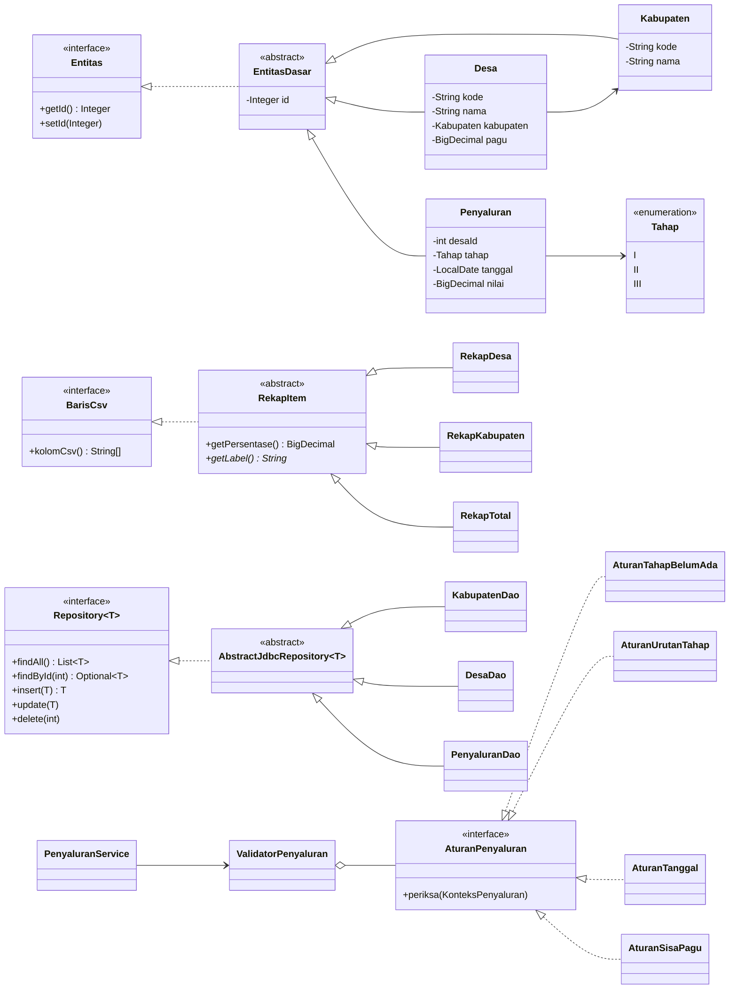
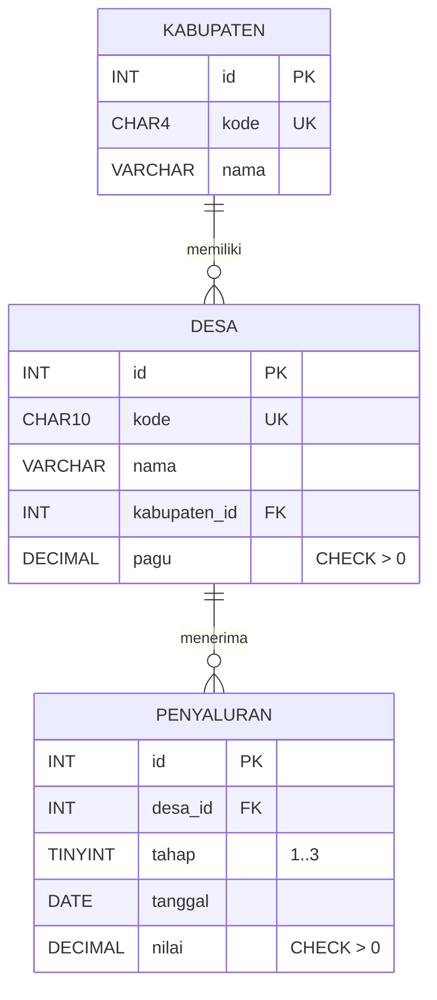

# Rancangan Aplikasi Pencatatan Penyaluran Dana Desa

> Bahan untuk Laporan bagian 2 (Identifikasi masalah) dan 3 (Rancangan).
> Seluruh data adalah data rekaan (dummy).

## 1. Identifikasi Masalah

**Masalah.** Penyaluran Dana Desa dilakukan bertahap (Tahap I, II, III). Bila dicatat manual (misalnya di spreadsheet), sering terjadi:
- total penyaluran melebihi pagu desa tanpa terdeteksi;
- tahap dicatat tidak berurutan (Tahap II dicatat padahal Tahap I belum ada) atau tercatat ganda;
- rekap per desa dan per kabupaten harus dihitung ulang manual setiap kali ada perubahan.

**Pengguna.** Petugas pengelola penyaluran dana desa (di satker/kabupaten) yang mencatat data desa, mencatat setiap penyaluran, dan menyusun rekap untuk pimpinan.

**Aturan bisnis** dan tempatnya di kode:

| No | Aturan | Kelas |
|----|--------|-------|
| 1 | Nilai penyaluran tidak boleh melebihi **sisa pagu** desa | `AturanSisaPagu` → `MelebihiSisaPaguException` |
| 2 | Satu desa hanya boleh punya **satu penyaluran per tahap** | `AturanTahapBelumAda` (+ `UNIQUE(desa_id, tahap)` di DB) |
| 3 | Tahap harus **berurutan**: II setelah I, III setelah II | `AturanUrutanTahap` |
| 4 | Tanggal tidak boleh di masa depan dan tidak boleh mendahului tahap sebelumnya | `AturanTanggal` |
| 5 | Pagu desa tidak boleh diubah menjadi lebih kecil dari total yang sudah tersalur | `DesaService.ubah` |
| 6 | Desa yang sudah punya penyaluran tidak boleh dihapus | `DesaService.hapus` (+ FK `ON DELETE RESTRICT`) |
| 7 | Kode desa 10 digit, 4 digit awal = kode kabupaten; kode unik | `ValidatorDesa`, `DesaService` |
| 8 | Hanya tahap terakhir yang boleh dihapus (supaya urutan tetap utuh) | `PenyaluranService.hapus` |

## 2. Arsitektur Lapisan

```
ui (Swing)  ──►  service (aturan bisnis, transaksi, rekap)  ──►  dao (JDBC)  ──►  MySQL
   │                    │                                         │
   └──────────── model (Desa, Penyaluran, Kabupaten, Rekap*) ─────┘
config: DatabaseConfig + ConnectionFactory (baca db.properties)
exception: hierarki exception aplikasi
```

## 3. Diagram Class (disederhanakan)



**Di mana polimorfisme dipakai sungguhan:**
1. `ValidatorPenyaluran.periksa()` memanggil `aturan.periksa(k)` untuk setiap elemen `List<AturanPenyaluran>`. Implementasi yang jalan tergantung objeknya.
2. `CsvExporter.tulis()` memanggil `b.kolomCsv()` pada `List<? extends BarisCsv>`. Rekap kabupaten dan baris TOTAL (`RekapKabupaten` + `RekapTotal`) ditulis lewat satu list `List<RekapItem>`.

**Hierarki exception:**
```
Exception
 └─ AplikasiException
     ├─ ValidasiException          (input kosong / bukan angka / format salah)
     ├─ AturanBisnisException      (melanggar aturan)
     │   └─ MelebihiSisaPaguException   ← custom exception utama
     └─ KonfigurasiException       (db.properties bermasalah)
RuntimeException
 └─ DataAksesException             (SQLException diterjemahkan ke pesan yang jelas)
```

## 4. Rancangan Tabel dan Relasi



- `desa.kabupaten_id → kabupaten.id`, `penyaluran.desa_id → desa.id`, keduanya `ON DELETE RESTRICT`.
- `UNIQUE (desa_id, tahap)` menjadi pengaman terakhir di database untuk aturan "satu tahap sekali".
- Uang memakai `DECIMAL(18,2)` di DB dan `BigDecimal` di Java (bukan `double`, supaya tidak ada galat pembulatan).

## 5. Alternatif Desain yang Dipertimbangkan

| # | Pilihan A | Pilihan B (dipilih) | Alasan |
|---|-----------|---------------------|--------|
| 1 | Nilai tahap jadi 3 kolom di tabel `desa` (`tahap1`, `tahap2`, `tahap3`) | Tabel `penyaluran` terpisah (1 baris per tahap) | B ternormalisasi: tiap tahap punya tanggal sendiri, bisa dihapus per tahap, ada relasi FK sungguhan, dan mudah ditambah tahap atau kolom baru. A lebih sederhana di-query, tetapi banyak kolom kosong dan tanggal tidak tercatat. |
| 2 | Semua validasi dalam satu method `if-else` panjang | Interface `AturanPenyaluran` + satu kelas per aturan | B: tiap aturan bisa diuji JUnit terpisah, aturan baru cukup tambah kelas tanpa mengubah yang lama. Kekurangannya, jumlah kelas lebih banyak. |
| 3 | Rekap dihitung di SQL (`GROUP BY` + `SUM`) | Data diambil lalu direkap di Java (Map + Stream API) | B memenuhi ketentuan "rekap memakai List/Map", logika rekap bisa diuji tanpa database, dan satu kali ambil data bisa menghasilkan rekap per desa, per kabupaten, dan total sekaligus. Untuk data sangat besar (ribuan desa ke atas), A lebih efisien. |
| 4 | Cek sisa pagu lalu `INSERT` tanpa transaksi | Transaksi + `SELECT ... FOR UPDATE` pada baris desa | Dengan A, dua penyaluran yang disimpan bersamaan bisa sama-sama lolos cek sisa pagu. B mengunci baris desa sampai `commit`, dan `rollback` bila aturan dilanggar. Sudah diuji dengan 2 thread paralel: hanya satu yang tersimpan. |
| 5 | Satu DAO per tabel, masing-masing menulis ulang kode JDBC | `Repository<T>` generik + `AbstractJdbcRepository<T>` | B menghilangkan duplikasi (buka koneksi, PreparedStatement, mapping); subclass hanya mengisi SQL dan mapper. |
| 6 | Kolom `tahap` bertipe `ENUM('I','II','III')` | `TINYINT` 1..3 + `CHECK` | B portabel ke PostgreSQL dan mudah dibandingkan urutannya; label "Tahap I" diurus `enum Tahap` di Java. |
